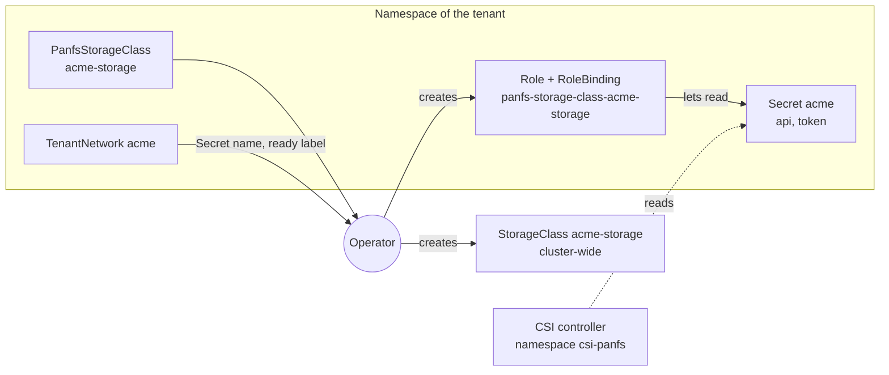
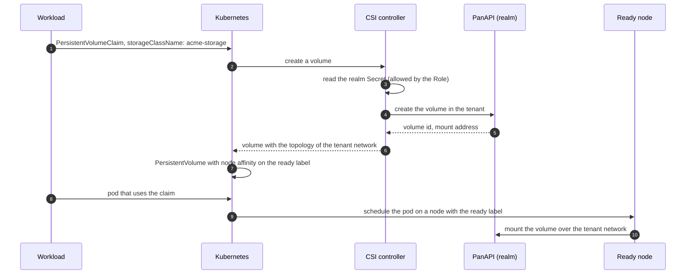
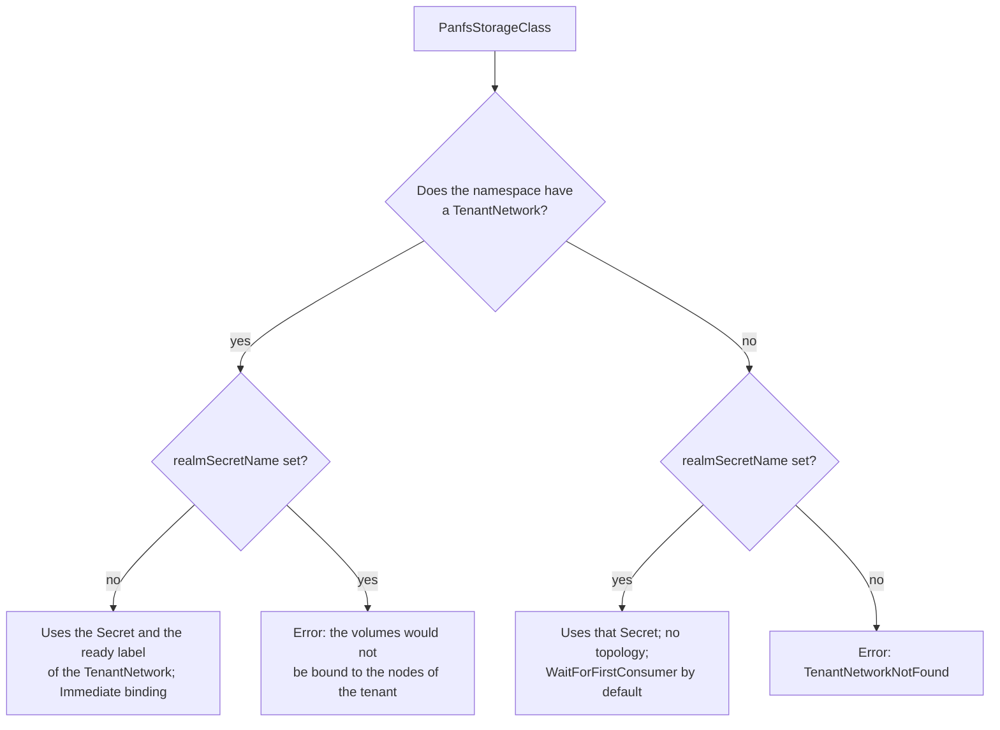
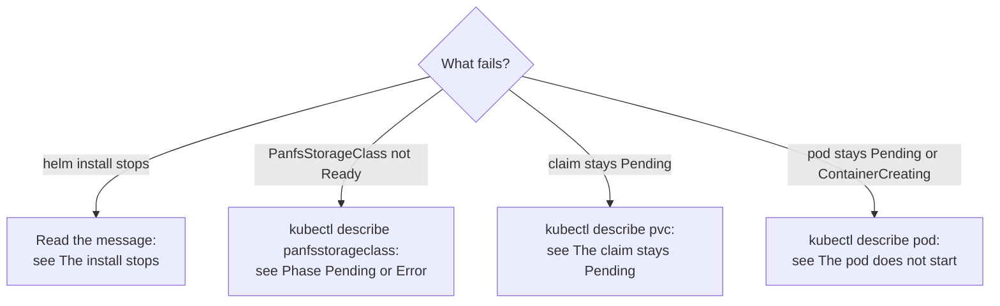

<!--
  Copyright 2025 VDURA Inc.

  Licensed under the Apache License, Version 2.0 (the "License");
  you may not use this file except in compliance with the License.
  You may obtain a copy of the License at

      http://www.apache.org/licenses/LICENSE-2.0

  Unless required by applicable law or agreed to in writing, software
  distributed under the License is distributed on an "AS IS" BASIS,
  WITHOUT WARRANTIES OR CONDITIONS OF ANY KIND, either express or implied.
  See the License for the specific language governing permissions and
  limitations under the License.
-->

# PanFS StorageClass: Deployment and Troubleshooting

A StorageClass of the PanFS CSI driver is created from a small `PanfsStorageClass` resource. This guide explains how
that works, how to create one with or without a tenant network, how to check it, and what to do when a claim does not
get a volume.

Before you start, install the [PanFS Tenant operator](Tenant-Operator-Guide.md). With a tenant network, set up the
tenant first with the [Tenant Guide](Tenant-Guide.md).

The full reference of the fields is in the [operator readme](../charts/panfs-tenant-operator/Readme.md#panfsstorageclass),
and of the chart values in the [StorageClass chart readme](../charts/storageclass/Readme.md).

## Table of Contents

- [What the operator builds](#what-the-operator-builds)
- [From a claim to a mounted volume](#from-a-claim-to-a-mounted-volume)
- [Where the Secret and the nodes come from](#where-the-secret-and-the-nodes-come-from)
- [Deploy a StorageClass](#deploy-a-storageclass)
- [Check the StorageClass](#check-the-storageclass)
- [Change or delete a StorageClass](#change-or-delete-a-storageclass)
- [Limits](#limits)
- [Troubleshooting](#troubleshooting)

## What the operator builds

You write only a name and, optionally, the PanFS parameters. The operator fills in the rest.



What the StorageClass gets:

| In the StorageClass                                                                  | Comes from                                                        |
|:-------------------------------------------------------------------------------------|:------------------------------------------------------------------|
| `provisioner`                                                                        | always `com.vdura.csi.panfs`                                      |
| `csi.storage.k8s.io/*-secret-name` and `-secret-namespace`                           | the Secret of the `TenantNetwork`, or `spec.realmSecretName`      |
| `allowedTopologies`                                                                  | the ready label of the tenant network (`status.managedTopology`)  |
| `volumeBindingMode`                                                                  | `Immediate` with a tenant network; `WaitForFirstConsumer` without |
| `parameters`, `reclaimPolicy`, `mountOptions`, `allowVolumeExpansion`, default class | the fields of the resource                                        |

## From a claim to a mounted volume



Because the PersistentVolume carries node affinity, a workload needs no node selector: Kubernetes places every pod
that uses the volume on a node where the tenant network works.

## Where the Secret and the nodes come from

The operator decides by the namespace of the resource and by `spec.realmSecretName`:



## Deploy a StorageClass

### With a tenant network

The tenant network must be `Ready`. Install one release of the StorageClass chart in the namespace of the tenant. The
name of the release is the name of the StorageClass, and no value is needed:

```bash
helm upgrade --install acme-storage charts/storageclass --namespace acme
```

Useful values:

| Value                                         | Example    | Effect                                              |
|:----------------------------------------------|:-----------|:----------------------------------------------------|
| `default`                                     | `true`     | the default StorageClass of the cluster             |
| `parameters."panfs.csi.vdura.com/storageset"` | `"1"`      | the storageset of new volumes, by id or by name     |
| `parameters."panfs.csi.vdura.com/layout"`     | `"raid6+"` | the layout of new volumes                           |
| `reclaimPolicy`                               | `Retain`   | keep the volume in the realm when the claim is gone |
| `mountOptions`                                | `[...]`    | mount options of the volumes                        |

Pass a parameter with `--set-string 'parameters.panfs\.csi\.vdura\.com/storageset=1'`. All PanFS parameters are listed
in the [StorageClass chart readme](../charts/storageclass/Readme.md#panfs-specific-volume-parameters).

### Without a tenant network

When the nodes reach the realm directly, create a namespace and a Secret, then name the Secret:

```bash
kubectl create namespace panfs-realm
kubectl -n panfs-realm create secret generic realm-credentials \
    --from-literal=api=<PANAPI_ADDRESS> \
    --from-literal=token=<TOKEN>

helm upgrade --install panfs-storage charts/storageclass \
    --namespace panfs-realm \
    --set realmSecretName=realm-credentials
```

### Without Helm

Apply the template `deploy/k8s/storage-class/template-panfsstorageclass.yaml` after you replace its placeholders; see
the [manifests readme](../deploy/k8s/Readme.md#4-deploying-the-storageclass). With the Makefile of the repository,
`make deploy-storageclass` creates a namespace, a Secret and a `PanfsStorageClass` from `REALM_API` and `REALM_TOKEN`.

### What the chart checks before the install

The chart stops, and creates nothing, when:

- the operator is not installed;
- the namespace has no `TenantNetwork` and `realmSecretName` is not set;
- the namespace has a `TenantNetwork` and `realmSecretName` is set;
- the `TenantNetwork` is not `Ready` yet (for a new release only);
- the Secret does not exist, or has no key `api` or `token`;
- another StorageClass already has the name of the release.

Set `checkNamespace=false` to skip these checks and let the operator report the state in the status of the resource.

## Check the StorageClass

```bash
helm test acme-storage --namespace acme
kubectl get panfsstorageclasses --all-namespaces
kubectl get storageclass acme-storage
```

`helm test` passes when the resource reaches the phase `Ready`. A healthy resource looks like this:

```text
NAMESPACE   NAME           STORAGECLASS   TENANT-NETWORK   PHASE   AGE
acme        acme-storage   acme-storage   acme             Ready   1m
```

To prove the whole chain, create a claim and a pod that writes to the volume:

```bash
kubectl apply -n <APP_NAMESPACE> -f examples/k8s/dynamic-provisioning/single-pod.yaml
kubectl -n <APP_NAMESPACE> get pvc,pod
```

The phases of a `PanfsStorageClass`:

| Phase     | Meaning                                                                                  |
|:----------|:-----------------------------------------------------------------------------------------|
| `Ready`   | the StorageClass is in place                                                             |
| `Pending` | the `TenantNetwork` is not ready yet; the StorageClass is created when it is             |
| `Error`   | the message says what is wrong; a new StorageClass is not created, an existing one stays |

## Change or delete a StorageClass

Kubernetes does not allow a change of the parameters, the reclaim policy or the binding mode of a StorageClass. The
operator therefore refuses a change of `spec.parameters`, `spec.reclaimPolicy`, `spec.volumeBindingMode` or
`spec.realmSecretName`: the resource shows the phase `Error` with the event `ImmutableField`. Undo the change, or
delete the resource and create it again. Existing volumes keep what they were created with.

A change of `spec.allowVolumeExpansion`, `spec.mountOptions` or `spec.default` is applied to the StorageClass.

To delete a StorageClass:

```bash
helm uninstall acme-storage --namespace acme
```

The operator deletes the StorageClass. While volumes of it exist, the `Role` and the `RoleBinding`
`panfs-storage-class-acme-storage` stay, because the CSI controller needs the Secret to expand and to delete those
volumes. The event `SecretReaderKept` says so. Delete them by hand when the volumes are gone:

```bash
kubectl -n acme delete role,rolebinding panfs-storage-class-acme-storage
```

## Limits

- **The name is unique in the cluster.** A StorageClass has no namespace. Two `PanfsStorageClass` resources with one
  name in two namespaces: the first one gets the StorageClass, the second one shows `StorageClassConflict`.
- **No delayed binding with a tenant network.** With `WaitForFirstConsumer`, the provisioner compares
  `allowedTopologies` with the labels that the CSI node plugin reported, and the ready label is not one of them. So no
  volume would be created, and the operator refuses that mode in the namespace of a `TenantNetwork`. Generic ephemeral
  volumes work with the `Immediate` StorageClass of the tenant.
- **A volume keeps its node affinity for life.** Do not move a `TenantNetwork` that has volumes to another namespace:
  the ready label would change, and the pods of the old volumes could not be placed.

## Troubleshooting



### The install stops

| Message of the chart                                                                  | Fix                                                                    |
|:--------------------------------------------------------------------------------------|:-----------------------------------------------------------------------|
| `The PanFS Tenant operator is not installed in this cluster`                          | install the operator first                                             |
| `Namespace "<ns>" has no TenantNetwork`                                               | pass `--namespace` with the tenant namespace, or set `realmSecretName` |
| `Namespace "<ns>" has the TenantNetwork "<name>", so realmSecretName must not be set` | remove `realmSecretName`                                               |
| `The TenantNetwork "<name>" ... is not ready`                                         | wait until it is `Ready`; see the [Tenant Guide](Tenant-Guide.md)      |
| `The Secret "<name>" ... does not exist` or `... has no key "api"`                    | create or fix the Secret                                               |
| `A StorageClass with the name "<name>" exists already`                                | choose another release name                                            |

### Phase `Pending` or `Error`

```bash
kubectl -n <NAMESPACE> describe panfsstorageclass <NAME>
```

| Event reason            | Phase     | Cause                                                                                  | Fix                                                |
|:------------------------|:----------|:---------------------------------------------------------------------------------------|:---------------------------------------------------|
| `TenantNetworkNotReady` | `Pending` | the `TenantNetwork` of the namespace is not ready yet                                  | wait, or fix the tenant network                    |
| `TenantNetworkNotFound` | `Error`   | no `TenantNetwork` in the namespace and no `realmSecretName`                           | use the tenant namespace, or set `realmSecretName` |
| `TenantNetworkUnclear`  | `Error`   | the namespace has several `TenantNetwork` resources                                    | keep one per namespace                             |
| `SecretNotFound`        | `Error`   | the Secret is missing                                                                  | create it with the keys `api` and `token`          |
| `StorageClassConflict`  | `Error`   | the name is taken by another resource or by a StorageClass the operator did not create | choose another name                                |
| `ImmutableField`        | `Error`   | a field that a StorageClass cannot change was changed                                  | undo the change, or delete and create again        |
| `InvalidSpec`           | `Error`   | a field is not valid, for example a `csi.storage.k8s.io/` parameter                    | fix the field the message names                    |
| `DriverNotFound`        | `Error`   | the CSIDriver object `com.vdura.csi.panfs` is missing                                  | install the CSI driver                             |

### The claim stays Pending

```bash
kubectl -n <APP_NAMESPACE> describe pvc <CLAIM>
```

| Event of the claim                                                         | Cause and fix                                                                                                                                                                                                |
|:---------------------------------------------------------------------------|:-------------------------------------------------------------------------------------------------------------------------------------------------------------------------------------------------------------|
| `Requested hard quota ... exceeds the 0 bytes available on storageset ...` | the quota of the tenant on the storageset is used up by the hard quotas of its volumes, even when the storageset is empty. Delete volumes that are not needed, or raise the quota of the tenant in the realm |
| `error generating accessibility requirements`                              | a StorageClass with `allowedTopologies` and `WaitForFirstConsumer`, for example one written by hand. Use the StorageClass of the operator, or `Immediate` binding                                            |
| `secrets "<name>" is forbidden` or `failed to get secret`                  | the CSI controller may not read the Secret: check that the `Role` and the `RoleBinding` `panfs-storage-class-<NAME>` exist, and that the driver namespace in the CSIDriver object is right                   |
| `401` or `403` from PanAPI                                                 | the token is wrong, expired, or lacks a permission on volumes                                                                                                                                                |

To see what the realm did with a request, the CSI controller logs it:

```bash
kubectl -n csi-panfs logs deployment/csi-panfs-controller -c csi-panfs-plugin --tail=50
```

### The pod does not start

| What you see                                           | Cause and fix                                                                                                                                       |
|:-------------------------------------------------------|:----------------------------------------------------------------------------------------------------------------------------------------------------|
| `Pending`, `node(s) had volume node affinity conflict` | no node has the ready label of the tenant: check the `TenantNetwork`; the pod starts when a node is ready                                           |
| `ContainerCreating`, mount errors on the node          | the node cannot reach the mount address over the tenant network; see the [Tenant Guide](Tenant-Guide.md#phase-pending-a-node-does-not-become-ready) |
| `Permission denied` inside the container               | the owner and the permissions of the volume: set `panfs.csi.vdura.com/user`, `group` and the `*perm` parameters, or `fsGroup` in the pod            |
