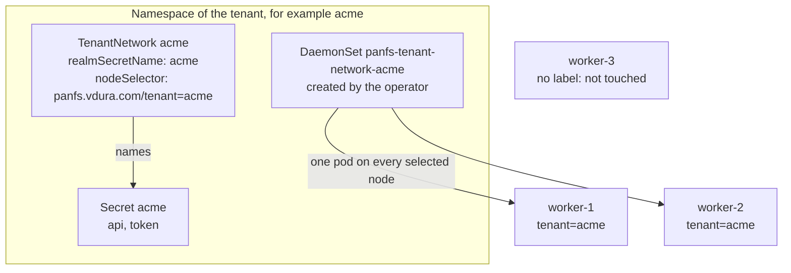
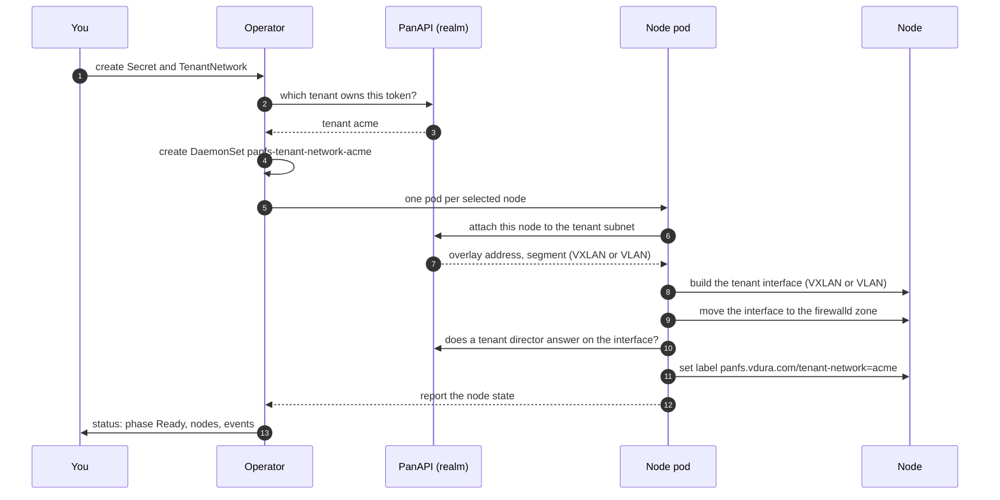
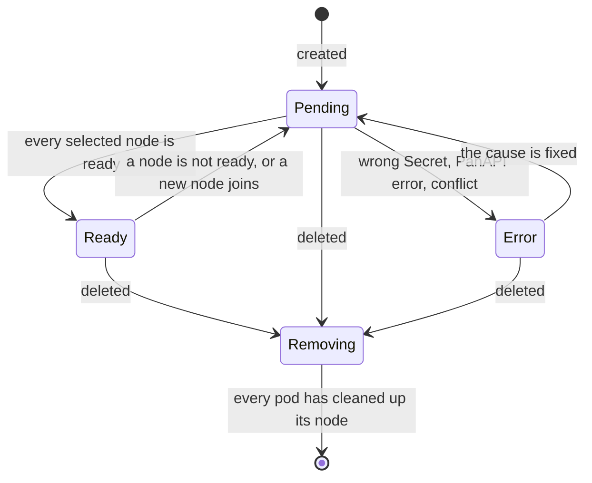
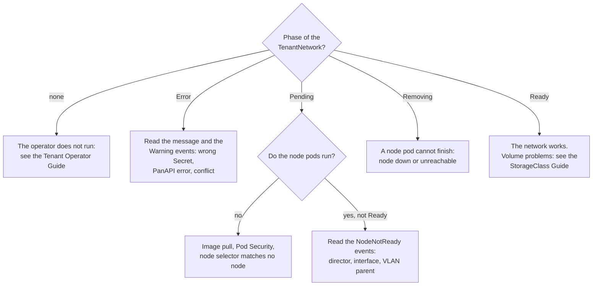

<!--
  Copyright 2025 VDURA Inc.

  Licensed under the Apache License, Version 2.0 (the "License");
  you may not use this file except in compliance with the License.
  You may obtain a copy of the License at

      http://www.apache.org/licenses/LICENSE-2.0

  Unless required by applicable law or agreed to in writing, software
  distributed under the License is distributed on an "AS IS" BASIS,
  WITHOUT WARRANTIES OR CONDITIONS OF ANY KIND, either express or implied.
  See the License for the specific language governing permissions and
  limitations under the License.
-->

# PanFS Tenant: Deployment and Troubleshooting

A volume of a PanFS tenant is reachable only from the network of that tenant. This guide explains how to put the
nodes of a Kubernetes cluster on that network with a `TenantNetwork`, how to check the result, and what to do when a
node does not become ready.

Before you start, install the [PanFS Tenant operator](Tenant-Operator-Guide.md). After the tenant is ready, create
its StorageClass with the [StorageClass Guide](StorageClass-Guide.md).

The full reference of the fields and of the chart values is in the
[operator readme](../charts/panfs-tenant-operator/Readme.md#tenant-network) and the
[tenant chart readme](../charts/tenant/Readme.md).

## Table of Contents

- [What a tenant is made of](#what-a-tenant-is-made-of)
- [What happens on a node](#what-happens-on-a-node)
- [Requirements](#requirements)
- [Deploy a tenant](#deploy-a-tenant)
- [Check the tenant](#check-the-tenant)
- [Change or remove a tenant](#change-or-remove-a-tenant)
- [Troubleshooting](#troubleshooting)

## What a tenant is made of

A tenant lives in a namespace of its own and needs two objects there:

- a **Secret** with the PanAPI address of the realm and the service account token of the tenant (keys `api` and
  `token`, and optionally `ca_cert`);
- a **TenantNetwork** that names the Secret and selects the nodes of the tenant.

The chart [`panfs-tenant`](../charts/tenant/Readme.md) creates both in one Helm release.



Two node labels are involved:

| Label                                                             | Who sets it  | Meaning                                          |
|:------------------------------------------------------------------|:-------------|:-------------------------------------------------|
| a label of your choice, for example `panfs.vdura.com/tenant=acme` | you          | the node is meant for this tenant                |
| `panfs.vdura.com/tenant-network=<namespace>`                      | the node pod | the network of the tenant works on this node now |

The second label is the *ready label*. The StorageClass of the tenant uses it, so Kubernetes places every pod with a
volume of the tenant on a node where the network works.

## What happens on a node



The pod repeats its checks every 30 seconds (`interval`). When the director stops answering, the pod removes the
ready label, and Kubernetes places no new pod with a tenant volume on that node.

The phase of a `TenantNetwork`:



## Requirements

- **The operator is installed.** The tenant chart stops with a message when it is not.
- **The tenant in the realm** has a subnet on a VXLAN or a VLAN segment, and a storageset.
- **The token** belongs to a service account of the tenant. It may read the tenant, list the subnets and read their
  mount recipe, and list, read, create and delete attachments of a subnet.
- **The namespace allows privileged pods.** The node pods use the host network and a `hostPath` volume, so the
  namespace needs the Pod Security level `privileged` on clusters that enforce Pod Security:

  ```bash
  kubectl label namespace <TENANT_NAMESPACE> pod-security.kubernetes.io/enforce=privileged
  ```

- **The image pull secret**, when the operator image is in a private registry, exists in the namespace of the tenant
  with the name the operator chart was given in `imagePullSecrets`.
- **One namespace, one `TenantNetwork`; one node, one tenant.** The operator refuses a second `TenantNetwork` in a
  namespace, a second `TenantNetwork` for the same tenant, and two `TenantNetwork` resources that select one node.
- **Calico is pinned to the node address.** With its default address detection, Calico can move a node to its new
  tenant address, and the network between the nodes then fails. Do this once per cluster, before the first tenant:

  ```bash
  kubectl -n kube-system set env daemonset/calico-node IP_AUTODETECTION_METHOD=kubernetes-internal-ip
  kubectl -n kube-system rollout status daemonset/calico-node
  ```

## Deploy a tenant

### 1. Label the nodes of the tenant

```bash
kubectl label node <NODE_NAME> panfs.vdura.com/tenant=<TENANT_NAMESPACE>
```

Any label works. Without a node selector in the next step, **all** nodes of the cluster are used, the control plane
nodes included.

### 2. Install the tenant chart

```bash
helm upgrade --install <TENANT_NAMESPACE> charts/tenant \
    --namespace <TENANT_NAMESPACE> --create-namespace \
    --set realm.api=<PANAPI_ADDRESS> \
    --set realm.token=<TOKEN> \
    --set 'nodeSelector.panfs\.vdura\.com/tenant=<TENANT_NAMESPACE>'
```

The chart checks before it creates anything: the operator is installed, and the namespace has no `TenantNetwork` of
another release. With `existingSecret`, it also checks that the Secret exists and has the keys `api` and `token`.

Options for the realm connection:

| Situation                                              | Values                                                                |
|:-------------------------------------------------------|:----------------------------------------------------------------------|
| the token must not be stored in Helm                   | create the Secret yourself, then `--set existingSecret=<SECRET_NAME>` |
| a private CA signed the realm certificate              | `--set-file realm.caCert=ca.pem`                                      |
| the certificate cannot be verified at all (test realm) | `--set realm.insecureSkipTLSVerify=true`                              |

Without Helm, apply a Secret and the template `deploy/k8s/tenant-operator/template-tenantnetwork.yaml`; see the
[manifests readme](../deploy/k8s/Readme.md).

### 3. Wait until the tenant is ready

```bash
helm test <TENANT_NAMESPACE> --namespace <TENANT_NAMESPACE>
```

The test passes when the `TenantNetwork` reaches the phase `Ready`, and fails after 300 seconds otherwise.

## Check the tenant

```bash
kubectl get tenantnetworks --all-namespaces -o wide
kubectl -n <TENANT_NAMESPACE> describe tenantnetwork <NAME>
kubectl get nodes --label-columns panfs.vdura.com/tenant,panfs.vdura.com/tenant-network
```

A healthy tenant looks like this:

```text
NAMESPACE   NAME   TENANT   NODES   READY   PHASE   TOPOLOGY-KEY                     TOPOLOGY-VALUE
acme        acme   acme     3       3       Ready   panfs.vdura.com/tenant-network   acme
```

The status lists every node with its state and its address on the tenant network. The events say what happened:

| Event                 | From     | Meaning                                                             |
|:----------------------|:---------|:--------------------------------------------------------------------|
| `SecretFound`         | operator | the Secret is valid; it names the tenant of the token               |
| `DaemonSetCreated`    | operator | the node pods are being started                                     |
| `NodeAttached`        | node pod | the node is attached to the tenant subnet, with its overlay address |
| `InterfaceConfigured` | node pod | the tenant interface was created or corrected                       |
| `FirewallZoneSet`     | node pod | the interface was moved to the firewalld zone                       |
| `NodeReady`           | node pod | a director answers; the ready label is set                          |
| `Ready`               | operator | the network works on every selected node                            |

## Change or remove a tenant

- **Add a node:** give it the label of the node selector. A pod starts on it within a minute.
- **Remove a node:** remove the label. Before its pod stops, it removes the ready label and the interface, and
  detaches the node in the realm. Move the pods with tenant volumes away from the node first.
- **Remove the tenant:** delete its StorageClasses first, then the tenant release, while the operator runs:

  ```bash
  helm uninstall <TENANT_NAMESPACE> --namespace <TENANT_NAMESPACE> --wait
  ```

  The delete waits until every pod has cleaned up its node. Do not delete the whole namespace at once: the pods can
  lose their permissions before they have cleaned up, and the interfaces and the attachments in the realm stay.

## Troubleshooting

Start with the status, the events and the logs of the node pods:

```bash
kubectl -n <TENANT_NAMESPACE> describe tenantnetwork <NAME>
kubectl -n <TENANT_NAMESPACE> get pods -o wide
kubectl -n <TENANT_NAMESPACE> logs -l panfs.vdura.com/tenant-network-name=<NAME> --tail=30
```



### The install stops

| Message of the chart                                                        | Fix                                                        |
|:----------------------------------------------------------------------------|:-----------------------------------------------------------|
| `The PanFS Tenant operator is not installed in this cluster`                | install the operator first                                 |
| `Namespace "<ns>" has the TenantNetwork "<name>" already`                   | use another namespace, or upgrade the release that owns it |
| `The Secret "<name>", which the value existingSecret names, does not exist` | create the Secret with the keys `api` and `token`          |
| `The Secret "<name>" ... has no key "api"`                                  | add the keys `api` and `token` to the Secret               |
| `Installation into the 'default' namespace is not permitted`                | pass `--namespace`                                         |

### Phase `Error`

The message in the status and the `Warning` events name the cause:

| Event reason          | Cause                                                          | Fix                                                             |
|:----------------------|:---------------------------------------------------------------|:----------------------------------------------------------------|
| `SecretNotFound`      | the Secret is missing, or has no key `api` or `token`          | create or fix the Secret named in `spec.realmSecretName`        |
| `PanAPIError`         | PanAPI refused the token, or cannot be reached                 | check the address and the token; see the certificate case below |
| `TenantAlreadyServed` | another `TenantNetwork` serves the same tenant                 | keep one `TenantNetwork` per tenant                             |
| `NodeSelectorOverlap` | a selected node belongs to another `TenantNetwork`             | give each tenant its own nodes                                  |
| `InvalidSpec`         | a field is not valid: interval, interface name, zone, selector | fix the field the message names                                 |

**The realm certificate cannot be verified.** The message ends with `Hint: the certificate of the realm cannot be
verified`. If a private CA signed the certificate, set `realm.caCert` to the certificate of that CA. If the
certificate has no subject alternative name, or for a test realm, set `realm.insecureSkipTLSVerify=true`. The
connection stays encrypted, but a host that poses as the realm can then read the token.

### Phase `Pending`: the node pods do not start

The message reads `waiting for the pods to start on N nodes`.

```bash
kubectl -n <TENANT_NAMESPACE> describe pod -l panfs.vdura.com/tenant-network-name=<NAME> | grep -A5 Events
```

| What you see                                        | Fix                                                                      |
|:----------------------------------------------------|:-------------------------------------------------------------------------|
| `ErrImagePull`, `FailedToRetrieveImagePullSecret`   | copy the image pull secret of the operator into the tenant namespace     |
| `violates PodSecurity "baseline"` or `"restricted"` | label the namespace with `pod-security.kubernetes.io/enforce=privileged` |
| `NODES` shows `0`                                   | no node has the label of `spec.nodeSelector`: label the nodes            |

### Phase `Pending`: a node does not become ready

The `NodeNotReady` event names the node and the reason. The most common ones:

| Message                                                                                  | Cause and fix                                                                                                                          |
|:-----------------------------------------------------------------------------------------|:---------------------------------------------------------------------------------------------------------------------------------------|
| `no tenant director answers on vxlan<VNI>`                                               | the node cannot reach the director over the tenant network: check the underlay network and the firewall between the node and the realm |
| `an interface <name> already exists on the node and was not created by the pod`          | another tool owns an interface with that name: remove it, or give the tenant another segment                                           |
| `VLAN parent interface "<name>" does not exist on the node`                              | fix `spec.vlanParentInterface`, or leave it empty                                                                                      |
| `no interface of the node has the underlay address <ip>; name the VLAN parent interface` | set `spec.vlanParentInterface` on a VLAN segment                                                                                       |
| `move <interface> to the firewalld zone <zone>`                                          | firewalld refused the zone: check `spec.firewalldZone`, or set it to `""`                                                              |

To look at the node itself:

```bash
ip -d link show vxlan<VNI>                 # or vlan<id>: the tenant interface and its settings
ip addr show vxlan<VNI>                    # the overlay address of the node
firewall-cmd --get-zone-of-interface=vxlan<VNI>
ping -I vxlan<VNI> -c 3 <DIRECTOR_ADDRESS> # the mount address that the StorageClass uses
```

### The nodes become `NotReady` after the tenant network was built

Calico moved the nodes to their tenant addresses, and the network between the nodes fails. Pin Calico to the node
address, as described in the [requirements](#requirements), and wait until `calico-node` is ready again.

### Phase `Removing` does not end

A node pod cannot confirm that it has cleaned up, usually because its node is powered off or unreachable. Bring the
node back, or delete its Node object when it is gone for good:

```bash
kubectl delete node <NODE_NAME>
```

### The ready label stays on a node after the tenant is gone

The operator removes ready labels whose namespace has no `TenantNetwork` any more, in its next pass. If the operator
is not installed any more, remove the label by hand:

```bash
kubectl label node <NODE_NAME> panfs.vdura.com/tenant-network-
```

The tenant interface and the attachment in the realm stay in that case: remove the interface with
`ip link delete <INTERFACE>` on the node, and the attachment in the realm.
