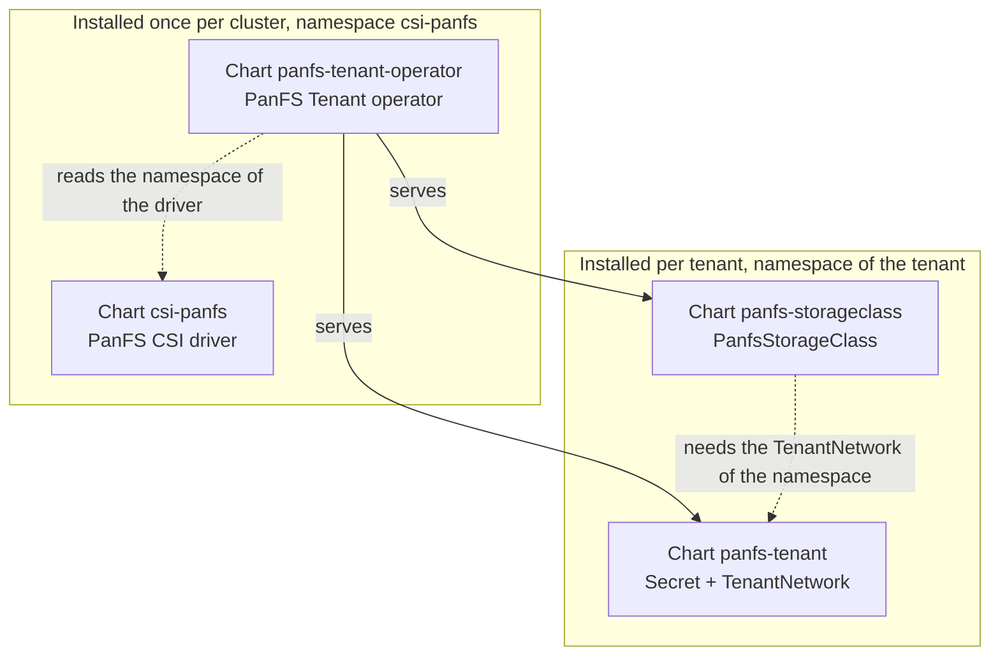
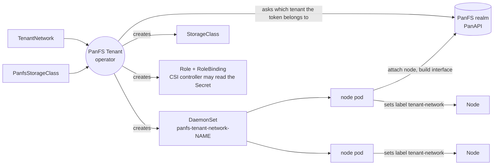
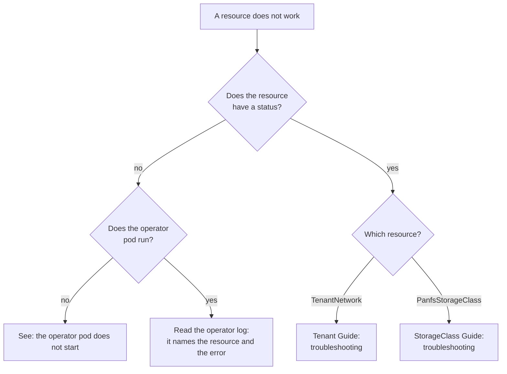

<!--
  Copyright 2025 VDURA Inc.

  Licensed under the Apache License, Version 2.0 (the "License");
  you may not use this file except in compliance with the License.
  You may obtain a copy of the License at

      http://www.apache.org/licenses/LICENSE-2.0

  Unless required by applicable law or agreed to in writing, software
  distributed under the License is distributed on an "AS IS" BASIS,
  WITHOUT WARRANTIES OR CONDITIONS OF ANY KIND, either express or implied.
  See the License for the specific language governing permissions and
  limitations under the License.
-->

# PanFS Tenant Operator: Deployment and Troubleshooting

This guide explains what the PanFS Tenant operator does, how to install it, how to check it, and what to do when it
does not work. Two related guides build on it:

- [Tenant Guide](Tenant-Guide.md): put the nodes of a cluster on the network of a PanFS tenant.
- [StorageClass Guide](StorageClass-Guide.md): create a StorageClass of the PanFS CSI driver.

The full reference of the chart values is in the [chart readme](../charts/panfs-tenant-operator/Readme.md).

## Table of Contents

- [What the operator does](#what-the-operator-does)
- [How the pieces fit together](#how-the-pieces-fit-together)
- [Requirements](#requirements)
- [Install the operator](#install-the-operator)
- [Check the installation](#check-the-installation)
- [Upgrade the operator](#upgrade-the-operator)
- [Uninstall the operator](#uninstall-the-operator)
- [Troubleshooting](#troubleshooting)

## What the operator does

The PanFS Tenant operator is one pod that runs once per cluster, next to the PanFS CSI driver.
It serves two custom resources of the API group `panfs.vdura.com/v1alpha1`:

| Resource            | You create it to                           | The operator then                                                                                  |
|:--------------------|:-------------------------------------------|:---------------------------------------------------------------------------------------------------|
| `TenantNetwork`     | put nodes on the network of a PanFS tenant | runs a pod on every selected node, which attaches the node to the tenant subnet and marks it ready |
| `PanfsStorageClass` | get a StorageClass of the PanFS CSI driver | creates the StorageClass and lets the CSI controller read the realm Secret                         |

You do not need both. A cluster whose nodes reach the realm without a tenant network uses only `PanfsStorageClass`.

## How the pieces fit together

The repository has four charts. You install the driver and the operator once per cluster, then one tenant release per
tenant and one StorageClass release per StorageClass.



What the operator creates for each resource:



The operator works in passes: every 15 seconds (`resync`) it reads all `TenantNetwork` and `PanfsStorageClass`
resources of the cluster and brings the cluster in line with them. A change can therefore take up to 15 seconds to
show in the status of a resource.

## Requirements

- **The PanFS CSI driver is installed.** The operator reads the namespace of the driver from the CSIDriver object
  `com.vdura.csi.panfs`. The chart stops the install when that object is missing.
- **A namespace other than `default`.** The examples use `csi-panfs`, the namespace of the driver.
- **The image can be pulled.** For an image in a private registry, the pull secret must exist in the namespace of the
  operator *and* in every tenant namespace, because the node pods of a tenant use the same image.
- **Helm 3 or later**, or `kubectl` for the static manifest.

## Install the operator

### With Helm

```bash
helm upgrade --install panfs-tenant-operator charts/panfs-tenant-operator \
    --namespace csi-panfs \
    --wait
```

For an image in a private registry:

```bash
helm upgrade --install panfs-tenant-operator charts/panfs-tenant-operator \
    --namespace csi-panfs \
    --set image=<REGISTRY>/panfs-tenant-operator:<TAG> \
    --set imagePullSecrets[0]=<PULL_SECRET_NAME> \
    --wait
```

The most used values are below; the [chart readme](../charts/panfs-tenant-operator/Readme.md#values) lists all.

| Value              | Default            | Use it to                                                  |
|:-------------------|:-------------------|:-----------------------------------------------------------|
| `image`            | the released image | run another image, for example a development build         |
| `imagePullSecrets` | none               | pull from a private registry                               |
| `resync`           | `15s`              | change the time between two passes of the operator         |
| `logLevel`         | `2`                | get more detail in the logs (`5` shows every step)         |
| `checkDriver`      | `true`             | install the operator before the driver (set it to `false`) |

### Without Helm

The static manifest installs the same objects for the namespace `csi-panfs`:

```bash
kubectl apply --server-side -f deploy/k8s/tenant-operator/panfs-tenant-operator.yaml
```

With the Makefile of the repository, `make deploy-tenant-operator` does the same. It uses Helm when `USE_HELM=true`,
and the image of `TENANT_OPERATOR_IMAGE`.

### What the installation creates

| Object                                 | Name                                     | Purpose                                                 |
|:---------------------------------------|:-----------------------------------------|:--------------------------------------------------------|
| `CustomResourceDefinition`             | `tenantnetworks.panfs.vdura.com`         | the `TenantNetwork` resource (short name `ptn`)         |
| `CustomResourceDefinition`             | `panfsstorageclasses.panfs.vdura.com`    | the `PanfsStorageClass` resource (short name `psc`)     |
| `Deployment`                           | `panfs-tenant-operator`                  | the operator, one pod                                   |
| `ServiceAccount`                       | `panfs-tenant-operator`                  | the identity of the operator                            |
| `ClusterRole` and `ClusterRoleBinding` | `<namespace>-panfs-tenant-operator`      | the permissions of the operator                         |
| `ClusterRole`                          | `<namespace>-panfs-tenant-operator-node` | the permissions of the node pods: read and label a node |

## Check the installation

```bash
# The operator pod runs
kubectl -n csi-panfs rollout status deployment/panfs-tenant-operator

# Both resource definitions exist
kubectl get crd tenantnetworks.panfs.vdura.com panfsstorageclasses.panfs.vdura.com

# The operator started and found the driver
kubectl -n csi-panfs logs deployment/panfs-tenant-operator | head -20
```

A healthy start shows the line `"starting panfs-tenant-operator" ... operator=true` and, a moment later, one line
`"running as the operator"`. The log lines of the two parts carry the names `logger="tenantnetwork"` and
`logger="storageclass"`.

## Upgrade the operator

```bash
helm upgrade panfs-tenant-operator charts/panfs-tenant-operator --namespace csi-panfs --reset-then-reuse-values --wait
```

Helm installs resource definitions only on the first install; it never upgrades them. Apply them yourself after an
upgrade of the chart:

```bash
kubectl apply --server-side -f charts/panfs-tenant-operator/crds/
```

When the image changes, the operator also updates the DaemonSet of every `TenantNetwork`. The node pods restart one
node at a time. A restart does not remove the tenant interface or detach the node, so mounted volumes keep working.

## Uninstall the operator

Remove the resources first, **while the operator runs**: every `PanfsStorageClass`, then every `TenantNetwork`.
Both carry a finalizer, and only the operator can release it.

```bash
kubectl delete panfsstorageclasses --all --all-namespaces
kubectl delete tenantnetworks --all --all-namespaces --timeout=10m

helm uninstall panfs-tenant-operator --namespace csi-panfs
kubectl delete crd tenantnetworks.panfs.vdura.com panfsstorageclasses.panfs.vdura.com
```

## Troubleshooting

Start with these four commands. They answer most questions.

```bash
kubectl -n csi-panfs get pods -l app=panfs-tenant-operator
kubectl -n csi-panfs logs deployment/panfs-tenant-operator --tail=50
kubectl get tenantnetworks,panfsstorageclasses --all-namespaces
kubectl get events --all-namespaces --field-selector involvedObject.kind=TenantNetwork --sort-by=.lastTimestamp
```



### The install stops with "The PanFS CSI driver is not installed in this cluster"

The chart found no CSIDriver object `com.vdura.csi.panfs`. Install the driver first (chart `csi-panfs`). To install
the operator before the driver on purpose, add `--set checkDriver=false`; the StorageClass part then reports
`DriverNotFound` until the driver is there.

### The install stops with "Installation into the 'default' namespace is not permitted"

Pass `--namespace csi-panfs`, or another namespace of your choice.

### The operator pod does not start

```bash
kubectl -n csi-panfs describe pod -l app=panfs-tenant-operator
```

| What you see in the events of the pod | Cause and fix                                                                                                             |
|:--------------------------------------|:--------------------------------------------------------------------------------------------------------------------------|
| `ErrImagePull` or `ImagePullBackOff`  | wrong image name, or no pull secret: set `image` and `imagePullSecrets`                                                   |
| `FailedCreate` with `forbidden`       | the namespace refuses the pod; the operator pod needs no special Pod Security level, so check the policies of the cluster |
| `CrashLoopBackOff`                    | read `kubectl -n csi-panfs logs deployment/panfs-tenant-operator --previous`                                              |

### A resource has no status at all

The operator writes a status in its first pass. A resource without a status after 30 seconds means the operator does
not run, or it cannot read the resource. Check the pod, then the log. A log line like
`cannot list the TenantNetworks` with `forbidden` means the ClusterRole of the operator is missing: install the chart
again.

### The log shows "cannot write an event ... unable to create new content in namespace"

The namespace of the resource is being deleted. The operator still cleans up, but Kubernetes refuses new events in a
namespace that terminates. You can ignore the line.

### A resource cannot be deleted: it waits for its finalizer

The operator removes the finalizer after it has cleaned up. If the operator does not run, start it again. If it is
gone for good, clean up by hand; the commands are in the
[chart readme](../charts/panfs-tenant-operator/Readme.md#uninstalling-the-operator).

### More detail in the logs

```bash
helm upgrade panfs-tenant-operator charts/panfs-tenant-operator --namespace csi-panfs --reset-then-reuse-values --set logLevel=5
```

The same value also sets the log level of the node pods of every tenant.
